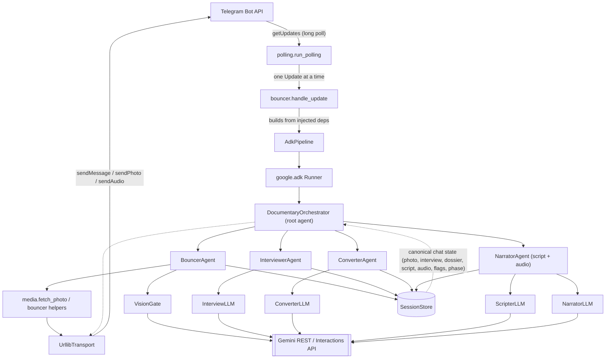
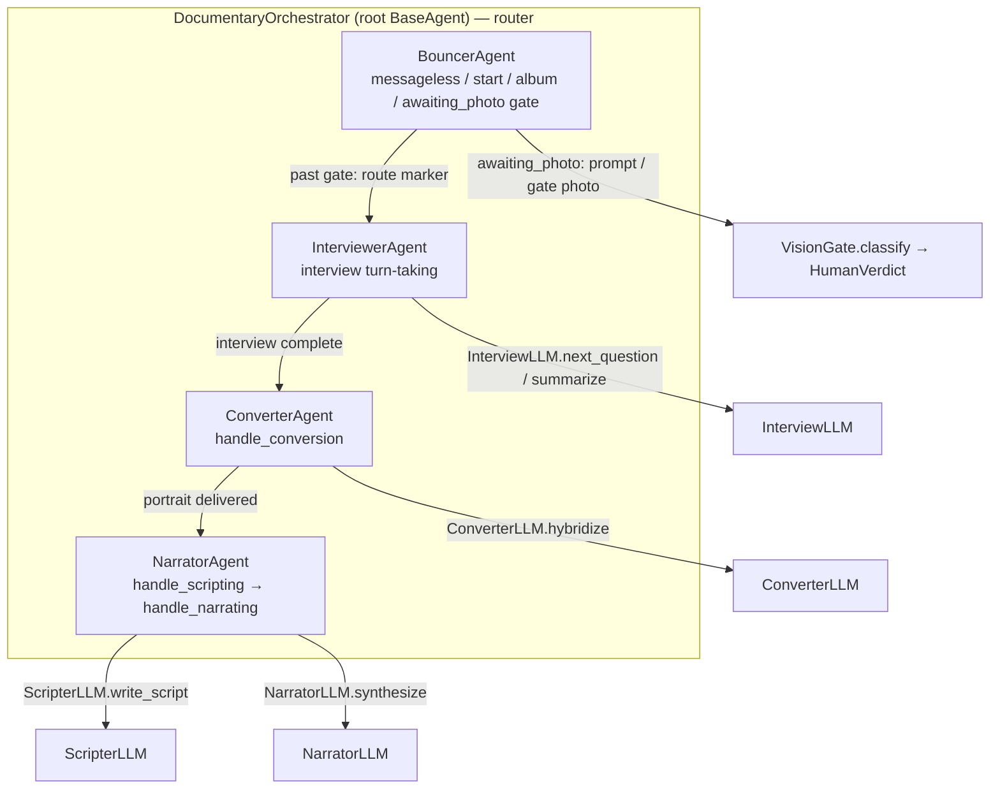
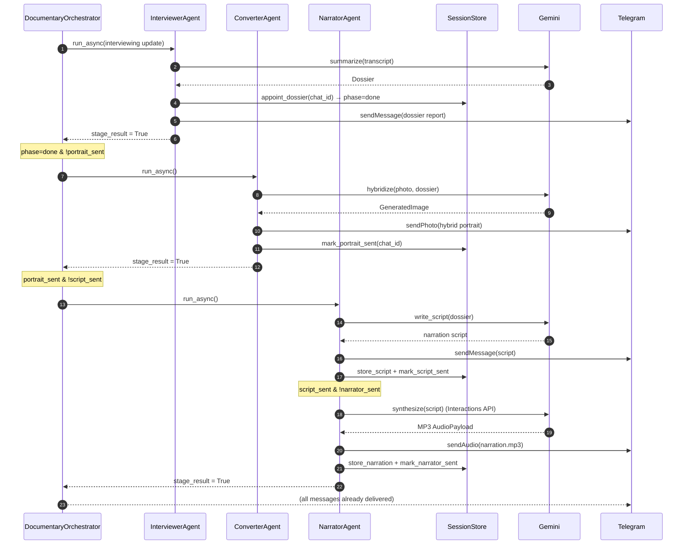

# Architecture — The Telegram Documentaries

This document is the visual companion to `SPECS/TECH.md`. It shows the live
runtime path (Phase 8: the pipeline is driven by a genuine **Google ADK** layer)
and the agent graph that wraps the existing typed ports.

The guiding rule: **`SessionStore` is the single source of truth**, and the ADK
layer is *thin* — every agent delegates to the same tested stage functions and
Gemini REST adapters that existed before Phase 8. No Gemini or transport logic
is re-implemented in the ADK layer.

## 1. System overview

The ADK session state carries only the **ephemeral per-update inputs** —
`chat_id` (int), `update` (JSON-safe `Update.model_dump`) and the encoded
`result` — never the canonical conversation. Injected dependencies (`session`,
`transport`, `gate`, `llm`, `converter`, `scripter`, `narrator`, `log`) are
process-side objects handed to the agents at construction time; they are never
serialised.

## 2. ADK agent graph

`DocumentaryOrchestrator` is the root `google.adk.agents.BaseAgent`; the four
stage agents are its `sub_agents`. Each `_run_async_impl` reads the ephemeral
inputs from `ctx.session.state` and calls the existing stage function behind a
narrow typed port. The **NarratorAgent folds the Scripter and Narrator stages**
(script generation/delivery then TTS synthesis/delivery) into one agent, so the
four-agent graph matches all five pipeline stages.

Routing (not just sequencing) lives in the orchestrator: it mirrors
`bouncer.handle_update` pre-routing and `bouncer._route_after_gate`, delegating
each stage to its sub-agent and writing the overall `bool | Skipped` to
`ctx.session.state["result"]`.

## 3. Generation handoff (sequence)

When an interview turn **completes** the interview, the dossier report, the
hybrid portrait, the narration script and the MP3 audio message all follow in a
**single update** — no user input in between. The orchestrator drives the chain
by invoking one sub-agent after another on the shared session.

## 4. Async & session model

- **One `asyncio.run` per update.** The gateway is synchronous and
  single-threaded; `AdkPipeline.handle` runs the async ADK path once via
  `asyncio.run`, which matches the existing bounded-synchronous stage model
  (the Converter's ~120 s call included).
- **One ADK session per `chat_id`.** `InMemorySessionService` is created once in
  `AdkPipeline.__init__`; a session (`user_id=str(chat_id)`,
  `session_id=str(chat_id)`) is created on first use and reused thereafter.
- **Skip encoding.** ADK copies the session on the way in/out of the runner, so
  the `SKIPPED` sentinel's identity does not survive the round-trip. A deliberate
  skip is encoded as the JSON-safe string `"skipped"` and decoded back to the
  `SKIPPED` singleton before `handle` returns, keeping the `bool | Skipped`
  contract intact.

## 5. Where to look

- Runtime orchestration: `telegram_documentaries/adk_orchestration.py`.
- Entry point / delegation: `bouncer.handle_update` (constructs an
  `AdkPipeline` from its injected dependencies and calls `handle`).
- Canonical state: `telegram_documentaries/session.py`.
- Ports + Gemini adapters: `vision.py`, `interviewer.py`, `converter.py`,
  `scripter.py`, `narrator.py` (all over the shared `gemini.py` client).
- Technical contract + phase details: `SPECS/TECH.md`.
